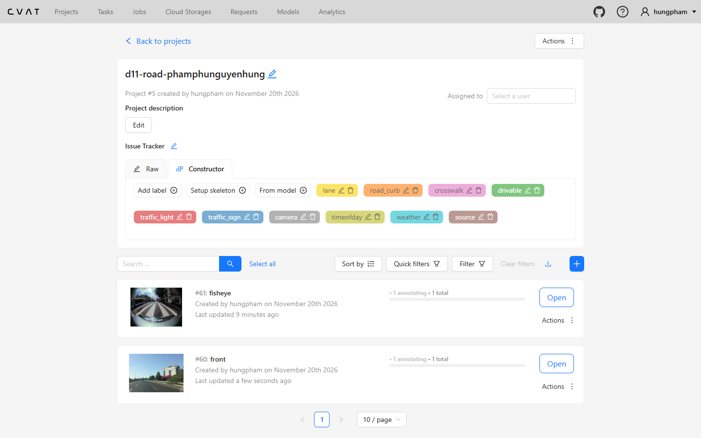
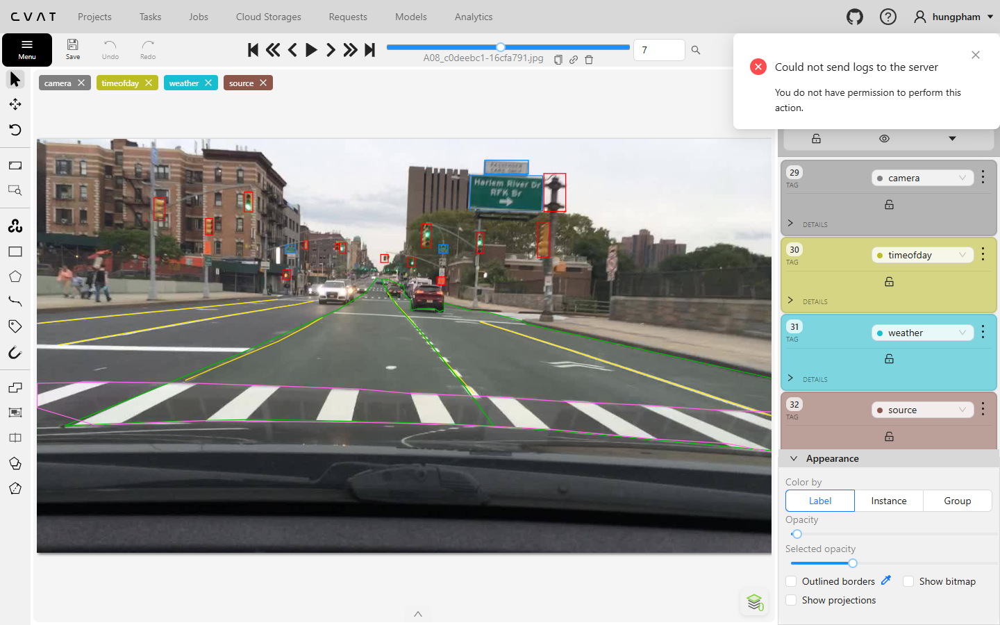
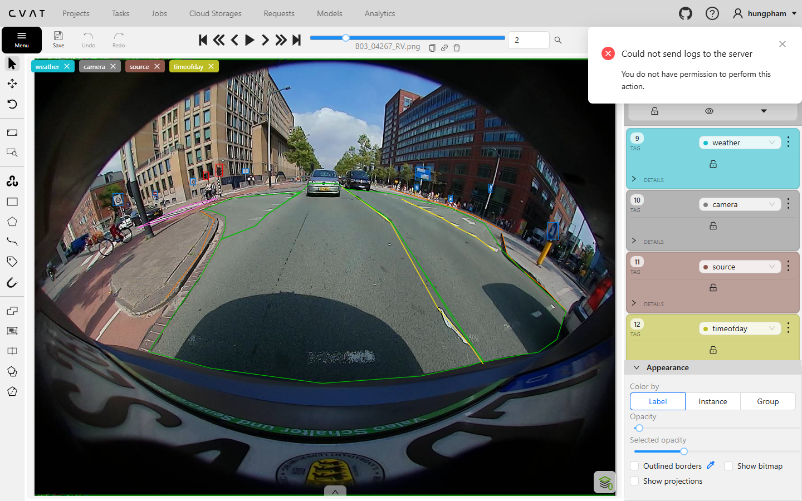
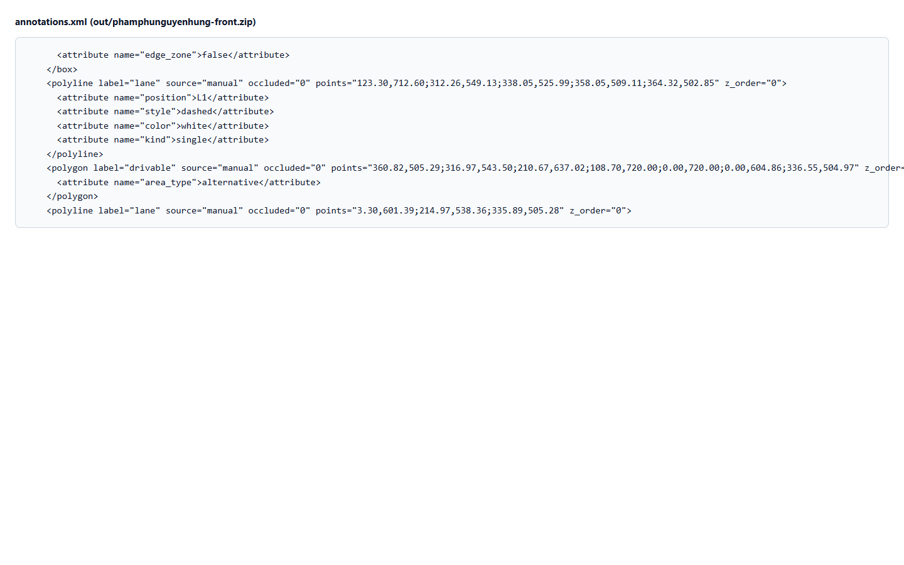

# Báo cáo cá nhân — Ngày 11

**Họ tên:** Phạm Phú Nguyên Hùng  
**Mã học viên:** 2A202604062  
**Phiên bản CVAT (Help → About):** 2.74.1 (local)  
**Guideline:** Road v1.0  
**Lần nộp (`revision` trong manifest):** 1  
**Thời điểm export:** 21/11/2026 10:29 (giờ máy, UTC+7)  
**Số lần nộp lại sau Rework:** 0

## 1. Kiểm project

| Mục | Đúng như guideline Road v1.0? | Ghi chú |
| --- | --- | --- |
| 6 label, đúng kiểu | Đúng | `lane`, `road_curb` là polyline; `crosswalk`, `drivable` là polygon; `traffic_light`, `traffic_sign` là rectangle |
| Thuộc tính và giá trị | Đúng | Sinh từ `road_lab.taxonomy.raw_labels()` |
| 4 tag ảnh | Đúng | `camera`, `timeofday`, `weather`, `source`, mỗi tag có một thuộc tính select `value` |

Cách kết thúc polyline trên bản CVAT này: nhấn `N` hoặc click đúp tại điểm cuối.  
Cách đặt tag ảnh trên bản CVAT này: dùng label kiểu Tag, chọn giá trị ở phần `Details`; một ảnh có đúng một tag cho mỗi label.

## 2. Số lượng đã gán

Số liệu đếm từ hai file zip nộp (export lại sau khi sửa vạch vàng đôi ở A04), theo nhóm ảnh. Mọi nhãn đều `source=manual`.

| Task | Ảnh | lane | road_curb | crosswalk | drivable | traffic_light | traffic_sign |
| --- | ---: | ---: | ---: | ---: | ---: | ---: | ---: |
| front | 12 | 36 | 1 | 4 | 28 | 39 | 23 |
| front-extra (đã làm 4 / 4) | 4 | 12 | 3 | 2 | 11 | 12 | 11 |
| fisheye | 8 | 7 | 16 | 14 | 11 | 6 | 10 |
| fisheye-extra (đã làm 4 / 4) | 4 | 1 | 6 | 4 | 6 | 1 | 1 |

Tổng 28 ảnh, 28/28 ảnh đủ 4 tag.

**Ghi chú về quy trình:** mình phải gán nhãn lại một lần nữa. Do lỗi thao tác của mình khi chạy script tự động mình tự viết, nhiều nhãn chưa gán bị mất hết, và quy trình cũ không có bản sao lưu nên không khôi phục được. Vì vậy phần lớn nhãn (vạch, đèn, biển, crosswalk) trong bài nộp là mình vẽ và kiểm lại bằng tay trên bản làm lại này; lần nộp vẫn là revision 1.

## 3. Bảng ca khó

| Ảnh | Nhãn | Phân vân giữa | Đã chọn | Lý do |
| --- | --- | --- | --- | --- |
| A05 | lane L1, R1 | Vẽ vạch hay để trống | Để trống | Đường chỉ có xe đỗ hai bên, không có vạch sơn. `lint` báo QC1-02 nhưng mình không vẽ vạch không có thật. **Chờ coach xác nhận.** |
| A07 | lane L1 | Vẽ vạch hay để trống | Để trống | Bên trái là dải phân cách bê tông, không có vạch sơn. **Chờ coach xác nhận.** |
| A09 | lane R1 | Vẽ vạch hay để trống | Để trống | Bên phải làn là mặt đường trống, không thấy vạch. **Chờ coach xác nhận.** |
| A14 | lane R1 | Vẽ vạch hay để trống | Để trống | Bên phải là vạch qua đường rẽ, không có vạch dọc. **Chờ coach xác nhận.** |
| A04, A11, A14 | lane (vàng đôi) | Một polyline hay hai polyline | Hai polyline, đều `kind=double` | Theo hướng dẫn của anh lab coach (nói miệng trên lớp): vạch đôi vẽ hai nét, mỗi nét một polyline, cùng thuộc tính `double`, để model học đây là hai vạch. Tài liệu `huong_dan_cvat_bang_hinh.md` cũng ghi "hai nét song song thì chọn `kind=double`". `lint` báo "2 polyline cùng position" ở A11 chỉ là gợi ý, không phải lỗi. |
| A08 | lane L1 | Vạch đứt mờ bên trái hay vạch liền gần hơn | Đứt mờ là L1, liền là L2 | L1 là vạch sát xe nhất; vạch đứt mờ nằm gần xe hơn vạch liền. |
| A06 | lane R1 | Có vạch bên phải không | Vẽ R1 theo vạch trắng ở góc dưới phải | Chỉ có một vạch rõ ở bên phải; không chắc đó là R1 hay R2. **Hỏi coach.** |
| B03 | traffic_light | `red/front` hay `unknown/side` | `unknown`, `side` | Ở độ phân giải này chỉ thấy vỏ đèn nhìn nghiêng, không thấy mặt đèn. Nếu là đèn quay về xe thì thành lỗi nặng QC1-08, cần lead xác nhận. |
| B03 | lane R1 | Dừng ở đoạn đứt đầu hay nối theo cung | Nối theo cung tới gần xe (~(990,675)) | Vạch đứt còn chạy tới gần xe, dừng sớm làm model mất đoạn gần. |
| A01, A04 | drivable | `alternative` là gì | `alternative` chỉ làn bên cạnh mà xe chuyển sang ngay; vùng không phải làn thì không gán | Theo cách hiểu của mình về quy định drivable; mình đã bỏ các polygon `alternative` ở fisheye vì không phải làn chuyển ngay. |

Ca mình chưa chắc nhất là A06 R1 và B03 đèn.

## 4. Phiếu QC 1 nhận được

**Bạn kiểm lô của mình:** Trần Nguyễn Phi Long (2A202604058)  
**Quyết định nhận được:** Rework (14 lỗi nặng; 28 lỗi chính / 67 nhãn = 41,8 %; mẫu 6 ảnh A01, A04, A07, A08, B03, B05)

Phiếu kiểm bản export cũ (revision 1 trước khi sửa), nên mình đối chiếu lại với dữ liệu hiện tại.

| Mã lỗi | Số lỗi | Đồng ý? | Đã sửa? |
| --- | ---: | --- | --- |
| QC1-02 đủ L1, R1 | 2 | Đồng ý | Đã sửa: thêm vạch vàng đôi L1 ở A04, thêm vạch đứt mờ L1 ở A08 |
| QC1-03 position | 12 | Đồng ý | Đã sửa: gán lại `position` theo phía thật của vạch (A01, A04, A07, A08). Lỗi do bản nháp từ script tự động của mình để gần hết lane là `L1` |
| QC1-04 điểm dừng | 1 | Đồng ý (B03) | Đã sửa: nối R1 theo cung tới gần xe |
| QC1-05 vạch đứt bị tách | 1 | Đồng ý (A08) | Đã sửa: nối đoạn xa vào R1 thành một polyline |
| QC1-06 style/color/kind | 1 | Đồng ý (A04 `kind=double` ở vạch trắng đơn) | Đã sửa: đổi thành `single` |
| QC1-07 vùng lái | 5 | Một phần | A08 crosswalk đã thêm; B05 polygon trên vỉa hè đã xóa; A04, A07 thiếu drivable: bản export cũ chưa có, bản hiện tại đã có `direct` và `alternative`; A01 `direct` tràn sang làn phải: chưa kiểm lại |
| QC1-08 đèn | 10 | Đồng ý | Đã sửa: thêm đèn A07, A08 (xanh xa, đi bộ, quay lưng); đèn nhìn nghiêng đổi `facing=side`; đèn B03 đổi `unknown/side` |
| QC1-09 group/facing | 3 | Đồng ý (B03 biển) | Đã sửa: 1 biển `information`, 2 biển `mandatory` |
| QC1-10 đủ biển | 7 | Đồng ý | Đã sửa: thêm biển ở A01 (2), A08 (3), B03 (1); biển "Harlem River Dr" của A08 đã có |
| QC1-11 fisheye | 0 | | |

Ba ca mơ hồ của Long (đèn B03, quy ước L/R camera lùi, `direct` ở camera bên) mình chưa có lời đáp, đang để chờ lead.

## 5. Kiểm file export

| File | Mở lại được? | Số shape ảnh 1 (job / file) | Số shape ảnh 2 (job / file) | Tag camera có trong XML? |
| --- | --- | --- | --- | --- |
| `phamphunguyenhung-front.zip` | Có | A01: 9 / 9 | A02: 7 / 7 | Có (`front`) |
| `phamphunguyenhung-fisheye.zip` | Có | B01: 4 / 4 | B02: 12 / 12 | Có (`fisheye_front`) |

Hai zip không kèm ảnh (chỉ có `annotations.xml`), sha256 khớp manifest, mọi job đã `completed`.

`road_check lint` còn các cảnh báo: QC1-02 ở A05, A07, A09, A14 (ảnh không có vạch, đã ghi ở mục 3 và chờ coach); QC1-05 gợi ý "2 polyline cùng position" ở A04, A11, A14 (vạch vàng đôi vẽ hai nét theo hướng dẫn của coach, không phải vạch đứt bị tách); 1 điểm lặp trong drivable A08 (lỗi nhẹ); 2 box đèn thấp hơn 8 px ở A03 (không bắt buộc).

## 6. Ảnh chụp màn hình

**1. Tab Labels của project**

**2. Ảnh camera trước A08 đã gán**

**3. Ảnh fisheye B03, phóng to polyline cong**

**4. Đoạn XML có `<polyline label="lane">`**

## 7. Tự đánh giá

**Lỗi mình mắc nhiều nhất hôm nay và cách tránh ở Ngày 20:**

Lỗi lớn nhất là `QC1-03` (sai `position`): 12 lỗi nặng trong phiếu của Long. Nguyên nhân là mình dùng nhãn nháp do script tự động mình viết sinh ra (lane do bộ dò trong script đó vẽ) và chỉ dựa vào `road_check lint` để tự QC. `lint` chỉ kiểm cấu trúc: có đủ L1/R1, có đủ tag, đúng chiều polyline; nó không biết vạch có nằm đúng vạch thật hay không. Vì vậy bản nháp tự động có nhiều lỗi mà `lint` không bắt được:

- Gần hết lane có `position = L1` (39/42), nên `lint` báo "thiếu R1" ở mọi ảnh.
- Khi mình sửa tự động, script ép một vạch sang phía bên kia để cho đủ L1/R1. Kết quả là vạch bên phải xe bị gán `L1` khi bên trái chỉ có dải phân cách. Bộ tự động cũng vẽ hai lane giả lên mui xe ở A05, nơi không có vạch nào.
- Vạch đứt bị tách thành hai polyline ở A08, và đoạn đầu chiếm nhầm `L1`, làm hai vạch trắng thật bên trái thành `L2` và `other`.
- Đèn và biển do bộ dò trong script của mình sinh ra có thuộc tính mặc định (`type=vehicle`, `facing=front`) dù có đèn đi bộ và đèn nhìn nghiêng; nhiều đèn và biển bị bỏ sót.

Ngoài ra, do lỗi thao tác của mình khi chạy script tự động mình tự viết, nhiều nhãn chưa gán bị mất hết; quy trình cũ không sao lưu nên mình phải gán lại một lần nữa. Lỗi này nằm ở cách mình chạy script, không phải ở bộ công cụ của lab. Bài học là phải sao lưu bản export của CVAT trước mỗi lần chạy script tự động.

Cách tránh ở Ngày 20: không tin nhãn nháp tự động chỉ vì `lint` sạch. Mình sẽ vẽ overlay từng nhãn lên ảnh gốc, kiểm tay `position`, thuộc tính và hình ở từng ảnh, rồi mới export. Trong script sửa tự động, mình đã bỏ nhánh ép gán sai: ảnh thiếu vạch một phía thì để thiếu và xin coach miễn, không gán sai `position`.

**Nhãn của mình đi vào model ở đâu? Một lỗi đã sửa làm model học sai thế nào:**

Ví dụ A07: vạch trắng liền sát bên phải xe bị gán `L1`. Hình polyline vẫn đúng vị trí nên nhìn ảnh không thấy lỗi, nhưng thuộc tính nói với model rằng vạch bên phải là vạch bên trái. Nếu dùng dữ liệu này để train model làn (row-anchor hoặc lane classifier), model học nhầm vị trí trái/phải của làn so với xe, và dự đoán sai làn đang đi khi giữ làn (LKA). Với vạch vàng đôi, hướng dẫn của coach là vẽ hai nét `double` để model học đó là hai vạch; nếu vẽ một nét thì model không phân biệt được vạch đôi với vạch đơn.

## 8. (Tùy chọn, buffer) Từ polyline đến đích row-anchor

Mình chưa làm phần này (không tính điểm), nên để trống.

| y | 720 | 680 | 640 | 600 | 560 |
| --- | ---: | ---: | ---: | ---: | ---: |
| x của chúng tôi | | | | | |
| x của bạn kia | | | | | |
